<a href="https://jlroch2024.github.io/TrueSight/">
  
</a>

<p align="center">
  <a href="https://jlroch2024.github.io/TrueSight/"></a>
  &nbsp;
  <a href="https://truesight-1088051639519.asia-southeast1.run.app/swagger-ui.html"></a>
  &nbsp;
  <a href="https://jlroch2024.github.io/TrueSight/sprint-tracker/"></a>
</p>

<p align="center">
  Upload your holdings. TrueSight reads each company's annual report, maps who it depends on,<br>
  and warns you when something breaks. Every link points to the sentence that proves it.
</p>


## How It Works


## The AI Never Gets the Last Word

What you see is always the company's own sentence, never the model's. This is the link in the recording above:

> Currently, we rely on suppliers such as Panasonic and Contemporary Amperex Technology Co. Limited (CATL) for these cells.
>
> [Tesla 10-K, filed 29 January 2026](https://www.sec.gov/Archives/edgar/data/1318605/000162828026003952/tsla-20251231.htm)

A quote that is not in the report is dropped. A second AI then reads the passage around it as a judge, and a link it
doubts raises no alerts. Confidence rises when both companies' reports name the link, and an analyst's decision
overrides both AIs, for every user.

## What You Can Do

<table>
  <tr><td width="190"><strong>See the Chain</strong></td><td>A living graph of your holdings, their suppliers and customers, and their suppliers' suppliers, read from each supplier's own report. Shared dependencies are marked, and the graph grows as results arrive</td></tr>
  <tr><td><strong>Check the Source</strong></td><td>Each link shows its sentence with the companies, what is supplied and any figure marked. Show in Report opens the SEC filing, scrolled to the sentence and highlighted</td></tr>
  <tr><td><strong>See How Much</strong></td><td>A customer's share of revenue, read from the filing's own XBRL tags and never from an AI: Apple was 91% of Cirrus Logic's net sales in fiscal 2026</td></tr>
  <tr><td><strong>Find Who Names You</strong></td><td>SEC full-text search finds other companies' reports that name your holding as a supplier or customer</td></tr>
  <tr><td><strong>Get Warned</strong></td><td>Google News and SEC 8-K filings for every company on the chain, checked each morning. Real disruptions become one alert per event, with its severity, the share of the portfolio it reaches and, once an analyst approves it, a suggested next step</td></tr>
  <tr><td><strong>Test a Failure</strong></td><td>Simulate Disruption shows which holdings a supplier going down would reach, and how much of the portfolio that is</td></tr>
  <tr><td><strong>Go Back in Time</strong></td><td>The SEC Filing Timeline redraws the graph from each year's reports, 2023 to today, and says which links are new and which are no longer named</td></tr>
  <tr><td><strong>Ask TrueSight</strong></td><td>Ask about your portfolio in plain words. Answers come only from TrueSight's own data, with the links they rely on drawn beside them</td></tr>
  <tr><td><strong>Take It With You</strong></td><td>Download Briefing makes a PDF of the holdings, open alerts, sole-source suppliers and biggest dependencies</td></tr>
  <tr><td><strong>Correct the AI</strong></td><td>Analysts approve or reject relationships, events and suggestions on the Analyst Desk, for every user, and can read every AI call and how often analysts agree with each AI step</td></tr>
</table>

On a phone, the workspace becomes one sheet at a time: Holdings, Alerts, Graph and Details.

## Measured on Real Filings

Every change to an AI prompt is scored on hand-labelled real samples before it merges, and the score is saved in
[`docs/examples/`](docs/examples/README.md).

| What is measured | Score |
|---|---|
| Links found in the part of a report Gemini reads (5 reports, hand-labelled) | 17 of 18 |
| Second-check judge: true links accepted, false links caught (60 claims) | 23 of 23, 37 of 37 |
| Noise filter: real disruptions caught, false alarms (80 headlines, 3 orders) | 91%, 1 in 174 |
| Headlines read on a busy day (Samsung, Tesla, NVIDIA: 17 to 19 in 24 hours) | All of them |

## Built With

Spring Boot · Java 21 · PostgreSQL · React · TypeScript · d3-force · Gemini · SEC EDGAR and XBRL · Google News · OpenPDF · Google Cloud Run

[Why Each Piece Is Here](docs/tech-stack.md) · [How the Live Site Is Deployed](docs/deployment.md) · [Rules for Contributors and AI Agents](AGENTS.md) · [Every Story](docs/stories/README.md)

<details>
<summary><strong>Run It Locally</strong></summary>

<br>

You need Git, Java 21, Node.js (LTS) and Docker Desktop, open. Copy `.env.example` to `.env` and fill in what you need.

```bash
docker compose up -d
```

```bash
cd backend && ./mvnw spring-boot:run
```

```bash
cd frontend && npm install && npm run dev
```

Open http://localhost:5173 and log in as `demo@truesight.local` with the password `truesight-demo`. This account exists only on laptops and in tests. The API docs are at http://localhost:8080/swagger-ui.html.

**Tests.** `./mvnw verify` in `backend/` (Docker must be running) and `npm test` in `frontend/`. They run on every pull request, and never call the SEC or Gemini: they use the real saved data in [`docs/examples/`](docs/examples/README.md).

</details>
