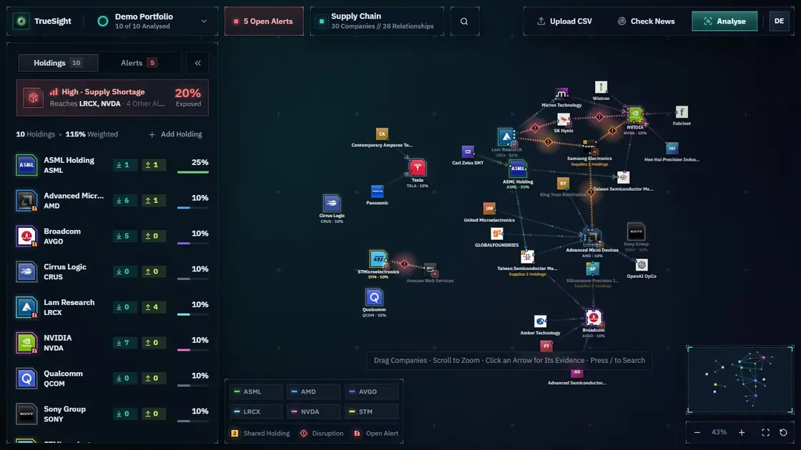

<a href="https://truesight-1088051639519.asia-southeast1.run.app">
  
</a>

<p align="center">
  <a href="https://truesight-1088051639519.asia-southeast1.run.app"></a>
  &nbsp;
  <a href="https://truesight-1088051639519.asia-southeast1.run.app/swagger-ui.html"></a>
</p>

<p align="center">
  Upload your holdings. TrueSight reads each company's annual report, maps who it depends on,<br>
  and warns you when something breaks. Every link points to the sentence that proves it.
</p>



## How It Works



## The AI Never Gets the Last Word

What you see is always the company's own sentence, never the model's. This is the link in the recording above:

> Currently, we rely on suppliers such as Panasonic and Contemporary Amperex Technology Co. Limited (CATL) for these cells.
>
> [Tesla 10-K, filed 29 January 2026](https://www.sec.gov/Archives/edgar/data/1318605/000162828026003952/tsla-20251231.htm)

## What You Can Do

<table>
  <tr><td width="170"><strong>See the Chain</strong></td><td>A live graph of your holdings, their suppliers and customers, with shared dependencies marked</td></tr>
  <tr><td><strong>Check the Source</strong></td><td>Show in Report opens the SEC filing, scrolled to the sentence and highlighted</td></tr>
  <tr><td><strong>Get Warned</strong></td><td>News about every company on the chain is screened, and real disruptions become alerts on the holdings they reach</td></tr>
  <tr><td><strong>Test a Failure</strong></td><td>What If It Stops? shows what a supplier going down would reach in your portfolio</td></tr>
  <tr><td><strong>Correct the AI</strong></td><td>Analysts approve or reject each finding on the Analyst Desk, for every user</td></tr>
</table>

## How Much of a Busy Day Is Read

A holding and its direct suppliers keep their newest 30 headlines a check (8-Ks first), a supplier's supplier its
newest 10. Checked by hand on Google News on 8 November 2026 (a Sunday, so a quiet day), with the search names
TrueSight now uses:

| Company | Headlines in the last 24 hours | Read before (10) | Read now (30) |
|---|---|---|---|
| Samsung Electronics | 19 | 53% | 100% |
| Tesla | 18 | 56% | 100% |
| Micron Technology | 4 | 100% | 100% |
| Taiwan Semiconductor Manufacturing | 5 | 100% | 100% |
| NVIDIA | 17 | 59% | 100% |

## Built With

Spring Boot · Java 21 · PostgreSQL · React · TypeScript · d3-force · Gemini · SEC EDGAR · Google Cloud Run

[Why Each Piece Is Here](docs/tech-stack.md) · [How the Live Site Is Deployed](docs/deployment.md) · [Rules for Contributors and AI Agents](AGENTS.md) · [Every Story](docs/stories/README.md)

<details>
<summary><strong>Run It Locally</strong></summary>

<br>

You need Git, Java 21, Node.js (LTS) and Docker Desktop, open. Copy `.env.example` to `.env` and fill in what you need.

```bash
docker compose up -d
```

```bash
cd backend && ./mvnw spring-boot:run
```

```bash
cd frontend && npm install && npm run dev
```

Open http://localhost:5173 and log in as `demo@truesight.local` with the password `truesight-demo`. This account exists only on laptops and in tests. The API docs are at http://localhost:8080/swagger-ui.html.

**Tests.** `./mvnw verify` in `backend/` (Docker must be running) and `npm test` in `frontend/`. They run on every pull request, and never call the SEC or Gemini: they use the real saved data in [`docs/examples/`](docs/examples/README.md).

</details>
